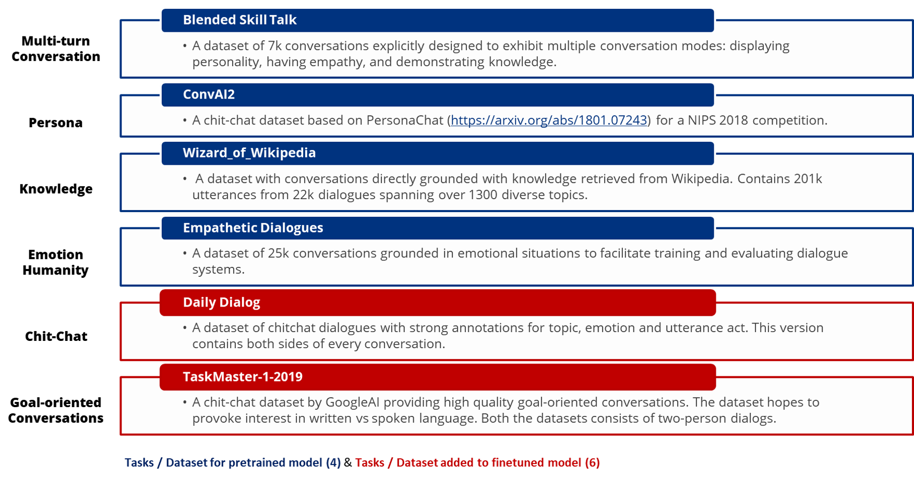
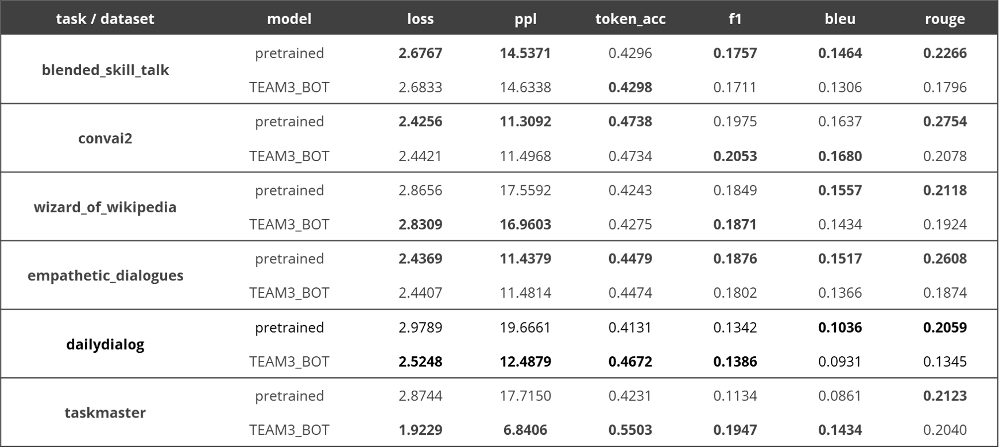

# CMU-Studio-Project
This project is conducted by IITP CMU studio project team 3. The purpose of project is developing a conversational AI chatbot. Our team implemented Parl AI from Facebook AI research team. 

Check the information in the [page](https://yongkyung-oh.github.io/CMU-Studio-Project/).

--------------------------------------------------------------------------------
Conversation Demo 1
<p align="center"></p>

Conversation Demo 2
<p align="center"></p>


--------------------------------------------------------------------------------


<p align="center"></p>

[](https://github.com/facebookresearch/ParlAI/blob/master/LICENSE) [](https://circleci.com/gh/facebookresearch/ParlAI/tree/master) [](https://github.com/facebookresearch/ParlAI/blob/master/CONTRIBUTING.md) [](https://twitter.com/parlai_parley)


--------------------------------------------------------------------------------


This repository is the implementation example of BST (Blended Skill Talk) model based on [Recipes for building an open-domain chatbot](https://parl.ai/projects/recipes/). It has minor modification of websocket and browser examples in the [original source](https://github.com/facebookresearch/ParlAI). Following files are modified.

#### modify `parlai/chat_service/tasks/chat_test/` from `~/chatbot/`
- Changed `config.yml`: Original code is using seq2seq model. In the modification, BST model(Blender 90M) is used.
- Changed `worlds.py`: Cusomize the messages. Add Google searching function by query and quick replies script.

#### modify `parlai/chat_service/services/browser_chat_test/` from `~/browser_chat/`
- Changed `client.py`: Instead of original script code, web_test code is used (interactive_web_test.py).

#### modify `parlai/scripts/interactive_web_test.py` from `~/interactive_web.py`
- Instead of `bulma`, `bootstrap` is implemented. 
- Customize the outlook and JavaScript functions.
- Add timestamp and custom information from `client.py`.

#### using fine-tuned model rather than pretrained model 

We added 2 more tasks to the BST model. Fine-tuned model path should be added in the `config.yml` file. In the public source code, BST 90M pretrained model will be loaded. 

<p align="center"></p>

<p align="center"></p>

--------------------------------------------------------------------------------


## Local CPU use

Use Python 3.11 in a new environment:

```bash
python3.11 -m venv .venv
. .venv/bin/activate
python -m pip install --upgrade pip==26.3
python -m pip install -e .
python -m parlai.scripts.interactive -m repeat_label
```

See [usage](docs/local-runtime.md) for checkpoint formats and local transports.
Blender 90M, GPU training, MTurk and Messenger deployment are outside this setup.

## License

ParlAI is MIT licensed. See [LICENSE](LICENSE) for details.
